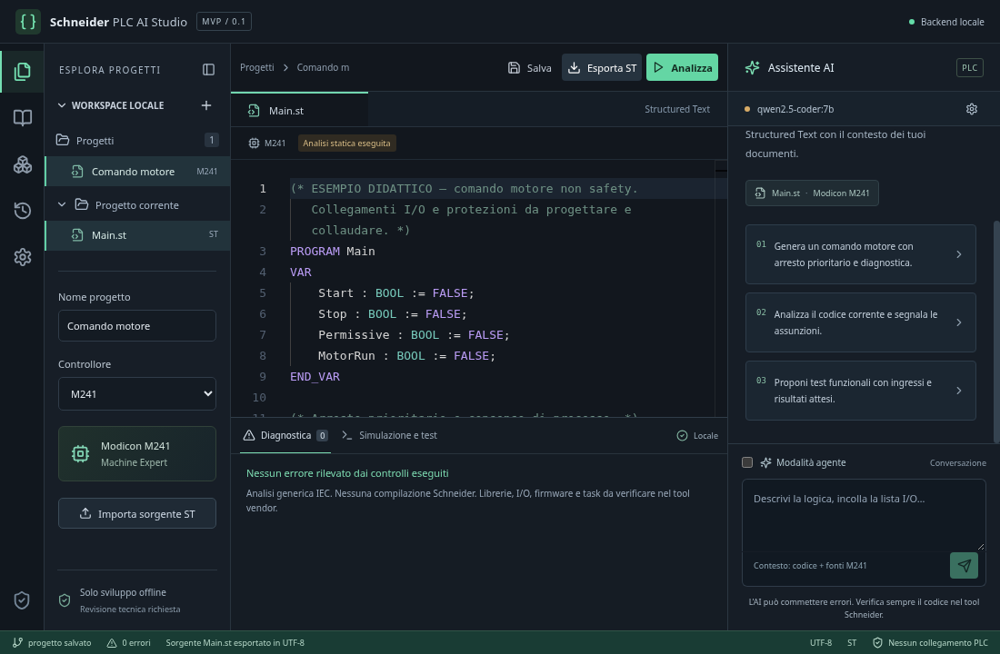
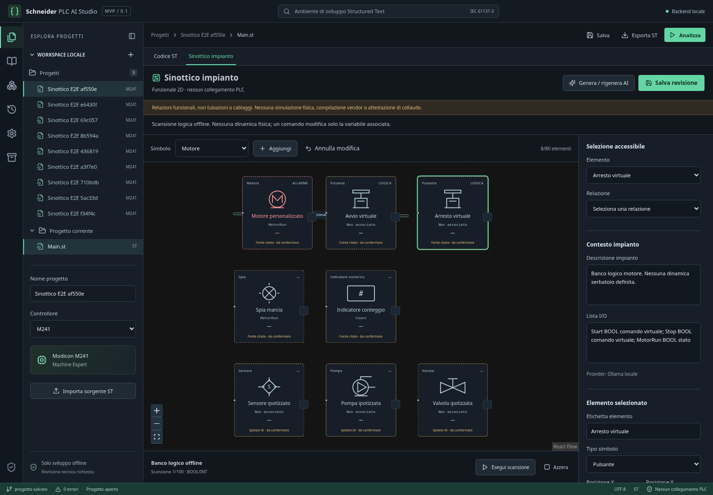
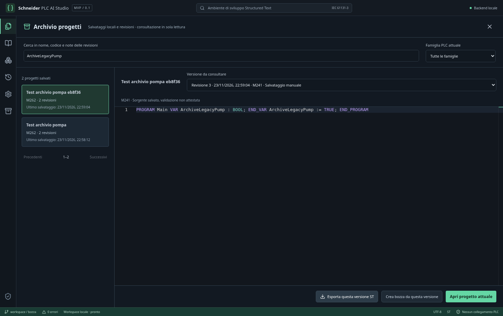

# Schneider PLC AI Studio

MVP desktop Windows per scrivere, analizzare e revisionare Structured Text con AI locale. Interfaccia italiana, tema scuro, Monaco Editor, FastAPI, SQLite e shell Electron. Progetto indipendente, non affiliato né certificato da Schneider Electric.



## Avvio Windows

Per il primo avvio seguire la [guida passo passo Windows](docs/INSTALLAZIONE_WINDOWS.md), con download dei prerequisiti, selezione della cartella, verifica di Ollama e risoluzione degli errori.

Requisiti: Windows 10/11 x64, Python 3.12, Node.js **22.12+** o 24, npm e Ollama installati. Per Qwen dimensionare RAM/VRAM sul modello scelto (il modello 7B quantizzato richiede diversi GB; nessuna GPU obbligatoria per il backend).

Da PowerShell nella cartella del progetto:

```powershell
./scripts/setup.ps1
ollama pull qwen2.5-coder:7b
npm run desktop
```

Avviare Ollama se il servizio non è già attivo. L'editor, i progetti e il linter funzionano anche con Ollama spento; l'assistente mostra un errore esplicito senza inventare una risposta. Il primo setup richiede internet per le dipendenze. Monaco e i suoi worker sono inclusi, senza CDN durante l'uso.

Se PowerShell impedisce l'esecuzione degli script, seguire la policy IT locale oppure eseguire manualmente i comandi contenuti in `scripts/setup.ps1`. Non sono necessari privilegi amministrativi per l'applicazione.

Configurazione opzionale prima dell'avvio:

```powershell
$env:OLLAMA_MODEL = 'qwen2.5-coder:7b'
$env:OLLAMA_URL = 'http://127.0.0.1:11434'
# Solo se si vuole usare un provider cloud compatibile OpenAI:
$env:CLOUD_API_URL = 'https://provider.example/v1'
$env:CLOUD_API_KEY = '<chiave personale>'
$env:CLOUD_MODEL = '<modello del provider>'
```

Il file `.env.example` è un riferimento: non viene caricato automaticamente. Il cloud è disattivato per impostazione predefinita e richiede selezione nella vista Impostazioni. Se selezionato, riceve codice, conversazione e frammenti documentali. Nessuna chiave è inviata al renderer.

## Uso dell'MVP

1. Impostare nome e famiglia PLC. Aprire un sorgente `.st` oppure modificare l'esempio didattico. Importazione e modifiche restano bozze.
2. Salvare: SQLite conserva progetto e revisioni. La vista Cronologia ripristina una revisione nella bozza; salvare di nuovo per conservarla.
3. Caricare PDF testuali, TXT, MD o ST in Documentazione: i frammenti sono associati alla famiglia selezionata. I documenti di altre famiglie sono esclusi dal retrieval. I PDF scansiti richiedono OCR esterno. Nessun manuale Schneider viene redistribuito.
4. Inviare specifica e lista I/O all'assistente. Il contesto include il codice corrente e fino a cinque fonti pertinenti. L'agente esegue al massimo tre cicli dalla UI (API: 1–5), con lint e, se proposti, scenari simulabili. Nessun file viene sovrascritto dall'AI: esaminare la proposta e scegliere **Applica alla bozza**.
5. Avviare **Analizza** per parser ST e controlli statici riutilizzati da plc-st-review. I risultati sono navigabili e riportati come marker Monaco. L'autocompletamento è IEC generico, non un catalogo di librerie Schneider.
6. In **Simulazione e test**, modificare i casi JSON e osservare le scansioni. Sono supportati un PROGRAM, BOOL/INT, inizializzazioni, assegnazioni, IF/ELSE, logica e confronti. Timer, FB, cicli, aritmetica e altri costrutti vengono rifiutati. Lo stato persiste fra scansioni della stessa richiesta, non fra richieste.
7. Archiviare sorgenti nella libreria blocchi. L'archiviazione non implica validazione. **Esporta ST** scarica direttamente `Main.st` in UTF-8, senza convertitori o tool di importazione. L’API `/api/export` offre anche un pacchetto opzionale con sorgente, manifest SHA-256, diagnostica e note tecniche.

## Sinottico impianto — MVP funzionale 2D

La scheda **Sinottico impianto**, accanto a Codice ST, rappresenta il programma con React Flow e simboli SVG locali per motori, pompe, valvole, serbatoi, sensori, pulsanti, spie e indicatori numerici. È un **sinottico funzionale**: le linee non attestano cablaggi o tubazioni; il grafico non è uno schema elettrico, un modello fisico, una compilazione vendor o un collaudo.

1. Aprire un progetto e compilare **Descrizione impianto** e **Lista I/O** nell’ispettore. Genera / rigenera AI invia codice ST completo (variabili e commenti inclusi), catalogo simboli ricavato dal parser e contesto alla stessa inferenza Ollama già configurata. Il cloud viene usato soltanto se selezionato esplicitamente nelle Impostazioni; in tal caso riceve anche layout e contesto impianto.
2. L’AI restituisce dati JSON validati con Pydantic: tipi di simbolo ammessi, coordinate finite, ID univoci, estremi dei collegamenti esistenti, limiti di dimensione e nessun campo eseguibile. Non vengono accettati SVG/HTML, script, espressioni o URL dal modello. Una risposta invalida o l’annullamento conservano il sinottico precedente.
3. **Fonte citata** indica una citazione riscontrata letteralmente nell’ST, I/O o descrizione. Non prova la correttezza semantica dell’associazione: va revisionata. Le inferenze e le citazioni non riscontrate sono **Ipotesi AI**. Confermare separatamente elementi, collegamenti e associazioni. Tutte le nuove conferme AI vengono azzerate dal backend.
4. Trascinare i simboli o modificare **Posizione X/Y**. Usare gli elenchi **Elemento del sinottico** e **Relazione del sinottico** per selezionare anche da tastiera o in caso di sovrapposizione. Modificare etichette, tipi e associazioni; collegare tramite handle oppure selettori Origine/Destinazione. Ogni linea è solo una relazione funzionale e non aggiunge logica o dinamica al simulatore.
5. Canali disponibili per ogni simbolo: stato BOOL, valore BOOL/INT, allarme BOOL, comando virtuale. L’elenco è ricavato dal parser IEC già presente. Un nome eliminato/rinominato, ambiguo, un tipo non supportato o una citazione divenuta obsoleta vengono segnalati. I possibili nuovi nomi sono suggerimenti: nessuna riassociazione automatica.
6. Per provare un comando, confermare l’associazione a una variabile **non scritta dal programma** e compatibile col simulatore; scegliere TRUE/FALSE o un INT e premere **Esegui scansione**. Anche le richieste dirette al backend vengono ricontrollate. Il comando è applicato come ingresso virtuale al solo interprete offline esistente. Una scansione per clic, massimo 100; stato e allarmi provengono dal risultato ST. La sessione rimane in memoria passando fra le schede; Azzera o una modifica al contesto/layout/codice avvia una nuova sessione.
7. Variabili non confermate o non supportate restano senza valore osservato (`—`). Timer, FB, REAL, cicli o altri costrutti fuori dal sottoinsieme rendono la scansione indisponibile: non viene attivato un simulatore alternativo. Nessuna evoluzione automatica di livelli, pressioni, portate o tempi viene inventata; un serbatoio non si riempie perché una pompa ha un BOOL attivo.
8. **Salva revisione** salva codice, layout, associazioni, conferme, descrizione e lista I/O atomicamente. Riapertura, Cronologia e copia dall’Archivio ripristinano il layout della revisione selezionata. Le vecchie revisioni senza sinottico si aprono con grafico vuoto. Gli stati runtime non vengono salvati come se fossero misure attuali.

La rigenerazione conserva interamente gli elementi modificati manualmente o confermati e mantiene le posizioni degli ID già esistenti. Gli elementi rimossi sono registrati con ID esclusi dalla rigenerazione; **Annulla modifica** ripristina l’ultima modifica. Gli elementi vecchi non restituiti dal modello vengono conservati prudentemente: possono richiedere pulizia manuale e non vengono eliminati in silenzio. Il modello è invitato a riusare gli ID; nuovi ID per lo stesso oggetto possono creare duplicati da revisionare.

Limiti MVP: 80 simboli, 160 relazioni, 16.000 caratteri ciascuno per descrizione e I/O, una POU/sorgente alla volta nel simulatore, un’associazione per canale senza formule. Sono rappresentazioni funzionali generiche, non simboli elettrici certificati. Nessun collegamento o comando verso PLC reali. Per uso industriale restano necessari verifica delle specifiche, compilazione nel tool vendor e collaudo tecnico.



Test dedicato: `scripts/smoke-synoptic.py` avvia una fixture locale del protocollo Ollama sulla porta 11555; richiede Vite e backend avviati con `OLLAMA_URL=http://127.0.0.1:11555` e **STUDIO_DATA temporaneo**. Verifica l’integrazione completa senza cloud o PLC, non la qualità generativa di un Qwen reale. Dipendenze opzionali del test: Python Playwright e Chromium di sistema. Non usare la fixture come provider di produzione.

## Archivio consultabile dei progetti precedenti

Il pulsante **Archivio progetti** nella barra laterale apre il repository locale di tutti i progetti salvati e delle relative revisioni. I dati già presenti sono disponibili automaticamente: non occorre importarli di nuovo. Ogni salvataggio nell’editor continua ad aggiornare il progetto e ad aggiungere una revisione persistente in SQLite.

- Ricerca nel nome attuale del progetto, nel codice attuale e storico e nelle note delle revisioni; i simboli `%` e `_` sono cercati letteralmente.
- Filtro sulla **famiglia PLC attuale** del progetto, elenco ordinato per ultimo salvataggio e pagine di 25 progetti.
- Selezione di una versione con data, famiglia e nota; il codice viene mostrato in un editor **in sola lettura**, senza attribuire automaticamente uno stato validato.
- **Esporta questa versione ST** scarica esattamente il sorgente selezionato in `Main.st`.
- **Apri progetto attuale** riapre la versione corrente nell’editor. **Crea bozza da questa versione** riusa una revisione come nuovo progetto: l’originale rimane invariato e la copia diventa persistente premendo Salva.

L’archivio rimane disponibile dopo la chiusura e il riavvio, nel database locale già usato dall’app. Non viene pubblicato su GitHub o sincronizzato in cloud. Le bozze mai salvate e i progetti conservati solo in altri computer/cartelle non compaiono automaticamente. Le note storiche sono consultabili ma il nome del progetto mostrato è quello attuale.



## Compatibilità reale e limiti

| Famiglia | Ambiente di destinazione | Supporto nell'MVP |
|---|---|---|
| M241, M251, M262 | EcoStruxure Machine Expert | Contesto AI, RAG per famiglia, ST testuale con trasferimento manuale a dichiarazioni/implementazione POU |
| M340, M580 | EcoStruxure Control Expert | Contesto AI, RAG per famiglia, ST testuale; variabili nel Data Editor e corpo nella sezione ST |

L’output è codice ST, da usare nel normale flusso dell’IDE Schneider: non occorre un tool di importazione dedicato. La conformità alle regole del target resta essenziale. Firmware, configurazione task, addressing I/O, librerie, EFB/DFB, tipi e temporizzazioni richiedono verifica nella versione effettiva dell'IDE. La sintassi vendor estesa può essere rifiutata dal parser generico oppure richiedere controlli aggiuntivi.

Il retrieval usa un indice vettoriale sparso locale in SQLite con hashing dei termini e similarità coseno. È un equivalente minimo dell'archivio vettoriale, **lessicale e non semantico**: non risolve bene sinonimi o domande senza parole comuni alle fonti. Non contiene conoscenza Schneider precaricata né embeddings neurali. Consultare le fonti mostrate; una citazione non dimostra che il modello abbia interpretato correttamente il manuale.

Nessun compilatore Schneider disponibile nell'MVP. `static_checked` significa solo che i controlli eseguiti non hanno rilevato errori: non significa programma corretto, compilato, sicuro o collaudato. `generated_unverified` resta lo stato delle proposte AI anche dopo lint/simulazione. Nessuna connessione o caricamento su PLC è implementata. Revisione tecnica, compilazione vendor e collaudo prima della messa in servizio. La simulazione non è una certificazione di sicurezza.

## Sviluppo e test

```bash
python3.12 -m venv .venv
.venv/bin/pip install -r backend/requirements-dev.txt
npm ci
STUDIO_DATA=./data .venv/bin/python backend/run.py
# Secondo terminale:
npm run dev
# Aprire http://127.0.0.1:5173
```

Test:

```bash
.venv/bin/python -m pytest backend/tests -q
npm run test:linter
npm run build
npm audit
```

Lo smoke test UI opzionale `scripts/smoke-ui.py` usa Python Playwright e Chromium di sistema (`/usr/bin/chromium` su Linux); richiede backend e Vite avviati e crea un progetto didattico nel database di sviluppo. Per il test non viene contattato alcun modello esterno.

## Installer Windows

La pipeline crea un installer NSIS per utente in `release/`; la GitHub Actions pubblica un artefatto scaricabile `plc-ai-studio-windows`. Il pacchetto incorpora frontend e backend, quindi il PC di destinazione non richiede Python o Node.js. Ollama e Qwen restano separati: installare Ollama e scaricare il modello se si desiderano le funzioni AI locali. Consultare la [guida Windows](docs/INSTALLAZIONE_WINDOWS.md) per i dettagli.

Su Windows, dopo setup:

```powershell
./scripts/package-windows.ps1
```

PyInstaller produce il backend standalone, electron-builder crea l'installer NSIS in `release/`. La pipeline `.github/workflows/windows.yml` esegue test e packaging su runner Windows. Installer non firmato: prima della distribuzione aziendale servono firma e verifica su macchina pulita. Il packaging Windows è predisposto ma **non eseguito né validato in questa sessione Linux**. Il download Electron inizialmente bloccato è stato risolto usando il proxy configurato. La shell Electron è stata verificata in modalità headless su Linux, inclusi backend automatico, token, Monaco, salvataggio, linter e download ST; questo non sostituisce il test dell’installer Windows.

L'app desktop avvia il backend su `127.0.0.1:8765`, con token casuale per sessione. I dati sono in `app.getPath('userData')/data` e il log è `backend.log` nella stessa cartella utente. In avvio manuale il default è `~/.plc-ai-studio`, modificabile con `STUDIO_DATA`. Fare backup del database a backend spento. Per sviluppo usare solo loopback; non esporre la modalità senza token in rete. La porta 8765 deve essere libera e una sola istanza desktop può essere attiva.

Vedi [architettura](docs/ARCHITECTURE.md), [analisi repository e licenze](docs/REPOSITORY_REVIEW.md), [attribuzioni](docs/THIRD_PARTY.md) e [avanzamento verificato](PROGRESS.md).
