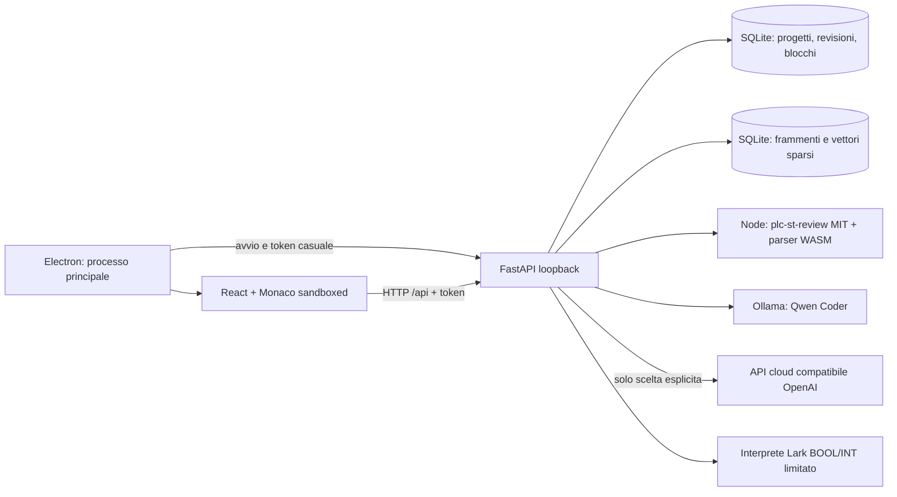

# Architettura

## Confini dei moduli

- `backend/studio/main.py`: contratti Pydantic, API, limiti richieste, documento e pacchetto export; nessun percorso file dal client viene eseguito.
- `archive.py`: catalogo in sola lettura di progetti e revisioni persistenti, ricerca parametrizzata anche nel codice storico, filtro sulla famiglia attuale, paginazione e dettaglio completo. Riusa il database e le revisioni esistenti; indice SQLite su project_id/id per le consultazioni. Nessun secondo archivio da sincronizzare.
- `storage.py`: transazioni SQLite con connessione per operazione, WAL, retrieval e filtri per famiglia. Revisioni immutabili includono il target al salvataggio. Documenti deduplicati per hash e famiglia. Il database conserva testo estratto, non PDF originali: nome, pagina e hash consentono riscontro con l'originale dell'utente.
- `ai.py`: contesto, cronologia limitata, provider selezionato, risposta JSON validata, lista citazioni filtrata, ciclo bounded. Proposte mai applicate automaticamente. Se il linter non è disponibile l'agente si arresta e lo dichiara nella traccia. Lint senza errori e test falliti provocano un altro ciclo; i test non simulabili restano esplicitamente unsupported.
- `analysis.py`: subprocess Node senza shell, input JSON su stdin e timeout 30 s; nessuna esecuzione del codice PLC. Esito unavailable separato da esito privo di errori. L'ambiente di Node usa ELECTRON_RUN_AS_NODE nel pacchetto desktop.
- `simulator.py`: grammatica esplicita Lark; interprete su tuple, senza eval/exec, shell o file eseguibili. Limite 30 kB/100 scansioni; tipi BOOL e INT signed 16 bit. Non modella scan temporale, mappatura fisica I/O, TON, EFB o scheduling. Inputs possono modificare qualsiasi simbolo dichiarato: è un banco didattico, non distingue canali fisici.
- `frontend/src/ArchiveBrowser.tsx`: consultazione separata con richieste cancellabili, editor in sola lettura, filtro, navigazione delle revisioni, esportazione e copia in nuova bozza.
- `frontend/src`: componenti React di workspace, API HTTP e registrazione linguaggio Monaco. Editor e worker inclusi nel bundle. Diagnostica su richiesta; aggiornare il codice invalida i precedenti risultati.
- `desktop`: shell Electron con contextIsolation, sandbox e nodeIntegration disabilitata. Preload espone soltanto il token; navigazione e nuove finestre bloccate. Frontend servito sul loopback dal backend, per supportare worker Monaco con origine HTTP. Asset e moduli del linter sono estratti da ASAR. Il processo backend viene terminato all'uscita.

## API essenziali

`GET /api/archive/projects?q=...&family=...&limit=25&offset=0`, `GET /api/archive/projects/{id}`.
`GET /api/health`, `/models`, `/projects`, `/documents`, `/blocks`.
`POST /api/projects`, `PUT /api/projects/{id}`, `GET /api/projects/{id}/revisions`.
`POST /api/analyze`, `/simulate`, `/chat`, `/export/st`, `/export`.
`POST /api/documents` multipart (file + family), `DELETE /api/documents/{id}`, `GET /api/search?q=...&family=...`.
OpenAPI generata da FastAPI in `/docs` (solo sviluppo locale; nessuna chiave nei contratti).

## RAG

Testo PDF estratto con pypdf per pagina; finestre 1200 caratteri, passo 1000. Indice 4096 dimensioni sparse, hashing SHA-256 dei token, normalizzazione L2. Scoring coseno esatto su documenti della famiglia o ALL. Top 5 con score positivo. Nessuna rete per indicizzare, nessun download automatico di manuali. Limiti 20 MB, 500 pagine, 2 milioni di caratteri estratti. Il recupero lessicale è una baseline per piccoli archivi: per scala industriale sostituire vector/retrieve con embeddings versionati e indice dedicato, mantenendo isolamento per famiglia e citazioni per pagina. Il limite PDF non è un isolamento di processo: PDF non fidati vanno trattati in un worker isolato prima di distribuire l'app in contesti ostili.

## Sicurezza e validazione

Host/origini locali consentite, token di sessione per endpoint API nel desktop. Nel dev il token è opzionale; impostare STUDIO_TOKEN se occorre usarlo con un client dedicato. Non è un servizio multiutente. Assenza di token nella modalità dev non è autenticazione industriale. I documenti sono dati non fidati nel prompt: le difese prompt non eliminano prompt injection; nessun tool operativo è assegnato al modello e nessuna proposta ha accesso al filesystem o ai PLC.

Lo stato di verifica non viene promosso a compilato. Esportazione include report, hash e istruzioni. Cronologia chat e tracce AI sono attualmente in memoria UI; i sorgenti applicati vanno salvati per versionarli. Audit tecnico non equivalente a revisione legale o certificazione. Le API cloud sono configurate dall'operatore, mai dall'output AI.

## Evoluzione prevista

1. Prova installer Windows e worker Monaco su macchina pulita; firma e SBOM di release.
2. Corpus Schneider autorizzato con versione firmware/IDE e metadati librerie; valutazione retrieval e citazioni.
3. Adattatori di compilazione offline vendor solo dopo aver verificato interfacce ufficiali, licenze e formati con round-trip di importazione.
4. Integrazione separata Beremiz/OpenPLC per simulazione IEC più ampia, con revisione copyleft e rete I/O disabilitata. Non duplicare un runtime IEC completo nel simulatore didattico.
5. Ampliare regole sintattiche per famiglia e cataloghi librerie su documentazione verificata. L’output rimane ST, senza tool di importazione dedicato (chiarimento utente).

## Sinottico funzionale 2D

`studio/synoptic_models.py` definisce il contratto JSON allowlisted (nessun codice eseguibile). `studio/synoptic.py` espone `/api/synoptic/inspect`, `/generate`, `/simulate`; usa `ai.request_json`, lo stesso trasporto/provider del chat e credenziali solo lato backend. Ollama riceve anche lo schema JSON in `format`; i cloud compatibili ricevono il vincolo JSON e lo schema nel contesto, poi la risposta è comunque validata localmente. Non esistono tool assegnati al modello.

`tools/lint.mjs` riusa `buildSymbolTable` del motore MIT per fornire nomi, tipi, scope e assegnazioni. Le limitazioni del parser IEC valgono anche per le associazioni. Il supporto simulazione è verificato usando l’interprete esistente, senza eseguire programmi nativi. I comandi sono indicizzati per ID nodo e tradotti in variabili solo dopo controlli su conferma, nome univoco, tipo e assenza di scritture ST. Replay bounded delle scansioni, nessuna sessione server mutabile o connessione PLC. Relazioni e posizioni non influiscono sulla logica simulata.

Le colonne JSON nullable `synoptic` in projects/revisions sono aggiunte con migrazione idempotente. Il salvataggio usa colonne esplicite, una transazione per codice + grafico + revisione; client precedenti che omettono il campo mantengono il layout esistente. Null esplicito lo rimuove. Nessuna tabella o revisione precedente viene eliminata. Il catalogo archivio continua a restituire solo riepiloghi e carica il sinottico nel dettaglio.

Il merge protegge l’intero elemento manuale/confermato, posizioni esistenti e tombstone delle eliminazioni. Non si tenta una fusione semantica rischiosa né un remapping automatico di variabili. Una citazione letterale assente viene degradata a ipotesi alla generazione; le citazioni diventate obsolete sono segnalate all’ispezione. Questo non prova la correttezza del significato della citazione.

Frontend in `src/synoptic/`: schema TypeScript, palette SVG fissa e vista React Flow controllata. Nessun markup dal modello. Edizioni invalidano i risultati di simulazione; richieste di ispezione cancellabili, generazione annullabile, risposte di un progetto cambiato scartate. Sessione di scansioni mantenuta in memoria dal workspace fra le schede, non inclusa nelle revisioni. UI di errore non cancella layout o testo. Dati bozza conservati dal progetto; solo Salva li rende persistenti.

`DESIGN.md` e `UX-CONTRACT.md` descrivono temi/semantica e comportamento; i token condivisi --studio-* in style.css alimentano l’adapter --plant-* di synoptic.css. Audit statico premium limitato al nuovo sottoalbero: non certifica conformità dell’intera UI preesistente.
